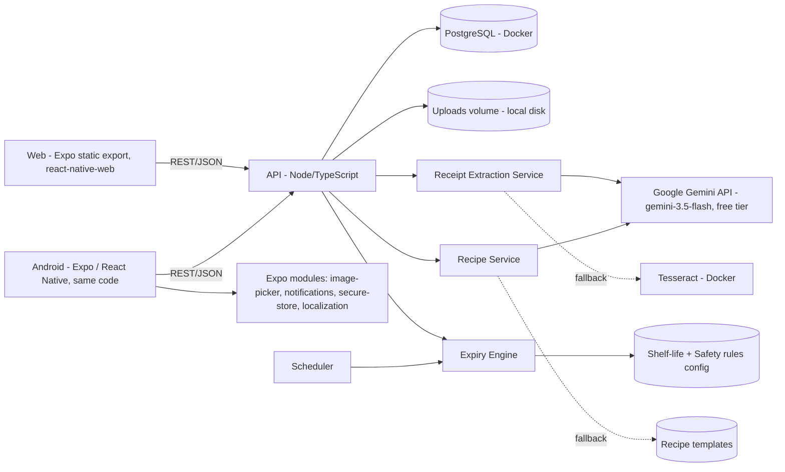
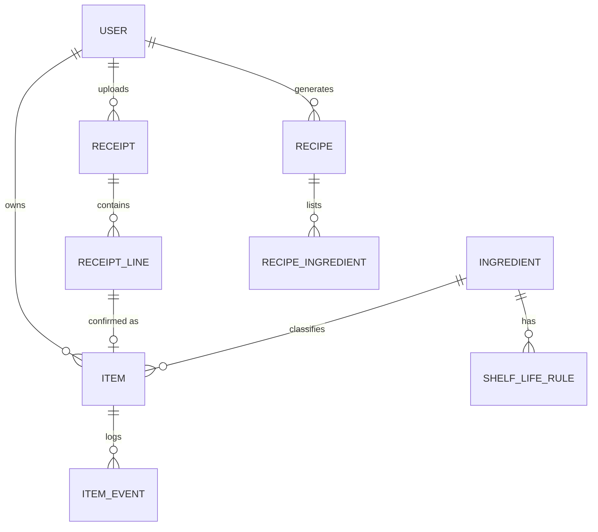
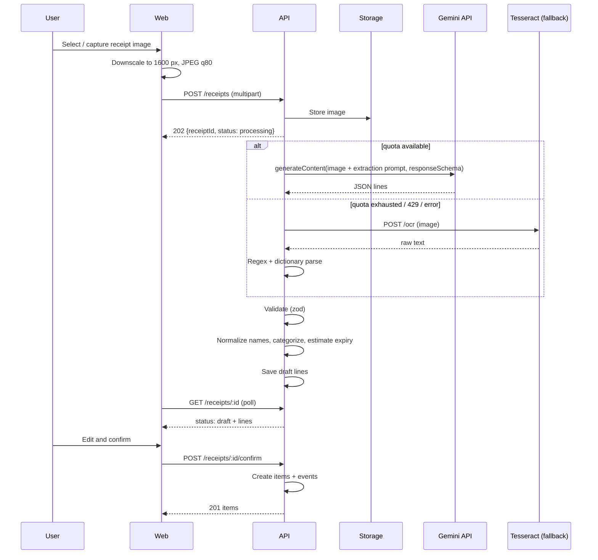

# Software Design Specification: Ghost Kitchen Inventory

Version 0.1 (MVP) | Date: 2026-11-10 | Companion to `SRS.md`

> Status note: this is the original design. The code differs in places. The `rules/*.json` files named below (other than `apps/mobile/lib/domain/rules/food-safety.json`) were not built as files: currency, abbreviation and recipe-template logic lives in code (`apps/mobile/lib/currency`, `apps/api/src/match.ts`, `apps/api/src/tonight.ts`). Where this document and the code disagree, the code is right.

## 1. Architecture Overview

One React Native codebase (Expo) ships as a native Android app and as a web app (react-native-web, static export). Both talk to the same REST API. The API orchestrates an OCR/extraction pipeline, an expiry engine, and a recipe generator. Data is persisted in PostgreSQL; images in object storage.



### 1.1 Technology Choices
| Concern | Choice | Rationale |
|---|---|---|
| Client (Android + web) | Expo SDK 57, React Native 0.86, Expo Router (file-based routes, typed), TypeScript | Truly native Android app and a web build from one codebase (NFR-COMP-2) |
| UI components | React Native Reusables (shadcn/ui port) on `@rn-primitives`, styled with NativeWind 4 (Tailwind 3 classes) | shadcn's copy-in, composable model and design tokens, working on native and web |
| Client state | Zustand, persisted to AsyncStorage; URL params for fridge filter/search/open item | Simple store; URL state makes Android back close the item sheet |
| Native features | `expo-image-picker` (camera + photo picker), `expo-localization` (default currency), `expo-notifications`, `expo-secure-store` (Clerk session tokens), `expo-sharing` (data export) and `expo-build-properties` (cleartext traffic off) | Maintained Expo modules, no custom native code |
| Animation | `react-native-reanimated` (stage glow, flies, ghost float), respects OS reduce-motion | Runs on the UI thread on Android |
| Backend | Node.js + Fastify + TypeScript | Shared types with frontend |
| DB | PostgreSQL through `pg`, tables created by `apps/api/src/store.ts` | Small schema, no ORM to keep in memory |
| AI (receipts + recipes) | Google Gemini API, model `gemini-3.5-flash`, free tier, via the official `@google/genai` SDK | Multimodal: reads the receipt image directly and returns structured JSON (`responseMimeType: application/json` + `responseSchema`); no local model, so near-zero host RAM |
| OCR fallback | Tesseract (open source) in a small `ocr` container + dictionary/regex parser | Keeps scanning working when the Gemini quota is exhausted or the API is unreachable |
| Recipe fallback | Bundled template set (`rules/recipe_templates.json`) ranked by at-risk items used | Recipes still work without Gemini |
| Storage | Docker volume on local disk for temporary receipt images | No extra service; images deleted after confirm |
| Scheduler | `node-cron` inside the API process | No extra container |
| Tests | Vitest (domain + API), Jest + React Native Testing Library (components), Maestro (Android E2E), Playwright (web E2E) | Unit, component and E2E on both targets |

All self-hosted services run in Docker via one `docker-compose.yml`, and the full system fits in 4 GB RAM (see 14.1). Everything is free: open-source images plus the Gemini API free tier. Providers sit behind interfaces (`AiProvider`, `OcrProvider`, `ObjectStore`), so the model or backend can be changed through env vars without code changes.

### 1.2 Gemini Integration
- **Key handling.** `GEMINI_API_KEY` lives only in the server `.env` and is read by the API container. It is never sent to, bundled in, or stored on the web or Android clients; all AI calls go through the API.
- **Model.** `GEMINI_MODEL=gemini-3.5-flash` (configurable). Temperature 0.2 for extraction, 0.7 for recipes.
- **Calls per action.** One call per receipt (image in, structured lines out). One call per "Summon recipes" (all three recipes in one response). Name normalization for manual entries uses the local dictionary first and only calls Gemini for unknown names, batched.
- **Free-tier quota guard.** Free-tier limits are per Google Cloud project and change over time, so they are configured rather than hard-coded (`GEMINI_RPM_LIMIT`, `GEMINI_RPD_LIMIT`, set them to the values shown in Google AI Studio for your project). The API keeps a token-bucket counter and a daily counter in Postgres. When a request would exceed the limit, or Gemini returns HTTP 429, the API switches to the fallback path and the UI shows "Spirits are resting, using offline mode".
- **Retries.** On 429/5xx: exponential backoff (1 s, 4 s) honoring `retry-after`, max 2 retries, then fallback.
- **Caching.** Recipe responses cached for 6 h keyed by a hash of (at-risk item ids + prefs); normalized names cached permanently in the `ingredients` table. This keeps a typical user to a handful of calls per day.
- **Per-user fairness.** Each user is limited to 10 receipt scans and 10 recipe generations per day (configurable) so one user cannot exhaust the shared free quota.
- **Validation.** All responses are validated with zod; Gemini output is never trusted for safety decisions (stage and discard rules stay local).
- **Privacy.** Only the receipt image (EXIF stripped) and ingredient names/preferences are sent. Note that on Google's free tier, submitted content may be used by Google to improve its products, so the app shows a one-time notice before the first scan and offers a "Tesseract only" privacy setting.

## 2. Component Design

### 2.1 Frontend Modules
| Module | Responsibility |
|---|---|
| `FridgeView` | Renders SVG fridge with zones, items, stage visuals, filter bar, detail drawer |
| `ItemSprite` | Draws an item with stage-based styling (glow, rot, flies, ghost) |
| `ScanView` | Upload, progress, and the confirmation table |
| `RecipeView` | Three recipe cards, detail, "Cook this" |
| `LedgerView` | Spend, waste avoided, wasted, at-risk value |
| `GraveyardView` | Discarded items history |
| `store` | Client state, optimistic updates, API client |

### 2.2 Backend Modules
| Module | Responsibility |
|---|---|
| `auth` | Sessions/JWT, user isolation |
| `receipts` | Upload, create extraction job, store parsed result as draft |
| `ai` | Gemini client, quota guard, retries, caching, fallback switching |
| `extraction` | Sends receipt image to Gemini (or Tesseract on fallback), validates against schema, normalizes names |
| `inventory` | CRUD on items, state transitions, zone assignment |
| `expiry` | Shelf-life lookup, stage computation, safety overrides |
| `recipes` | Ingredient selection, prompt build, response validation |
| `ledger` | Aggregations for spend, saved, wasted |
| `jobs` | Daily recalculation, cleanup of unconfirmed drafts |

### 2.3 Cross-Platform Design (Web + Android)

**Repository layout**
```
/apps/mobile      Expo app: Android + web (app/ routes, components/, lib/)
/apps/mobile/android   Generated by `expo prebuild` / EAS (not committed)
/apps/api         Fastify API
/packages/shared  Types, zod schemas, stage calculation
```

**Platform differences.** Most Expo modules work on both targets; where they differ, the code branches with `Platform.OS` or a `.web.ts` file.

| Concern | Web | Android |
|---|---|---|
| Receipt capture | `expo-image-picker` (opens the browser file dialog) | `expo-image-picker`: native camera with permission prompt, system photo picker |
| Notifications | In-app banner on open | `expo-notifications` local notifications (per item + daily digest) |
| Token storage | httpOnly cookie session | `expo-secure-store` (Android Keystore) |
| Share | Web Share API / clipboard | RN `Share` (native share sheet) |
| Back | Browser history | Hardware back: closes sheet (RN `Modal` `onRequestClose`), then tab history (`backBehavior="history"`), then exits |
| Food photos | Hidden file input with `capture` (opens the phone camera on mobile browsers); resized with `expo-image-manipulator` and kept as a ~40 KB JPEG data URI | `expo-image-picker` camera (falls back to the system photo picker if camera permission is denied), square crop, resized to 480 px, saved in the app document directory via `expo-file-system` |

**Responsive layout.** Breakpoint at 800 px.
- Desktop (>= 800 px): left rail navigation, central fridge, right detail panel and haunt summary.
- Mobile / Android (< 800 px): full-width fridge, bottom navigation bar (Fridge, Scan, Recipes, Ledger), item details in a bottom sheet, a floating Scan button, touch targets >= 48 dp, safe-area insets applied.

**Auth differences.** Web uses an httpOnly cookie; Android uses a bearer access token plus refresh token kept in secure storage. The API accepts both.

**Offline (Android, read-only).** Last `GET /items` and `/ledger` responses cached in local storage; stage is recomputed on-device using the shared `stage()` function so freshness stays correct offline. Mutating actions are disabled when offline and show a banner.

**Notifications (Android).** After each sync, the app cancels and reschedules notifications: one per item at its Expiring transition time (default 9:00 local) and an optional daily digest. Permission (Android 13+ `POST_NOTIFICATIONS`) is requested after the first confirmed receipt, not at launch.

**Android permissions.** `CAMERA`, `POST_NOTIFICATIONS`, `INTERNET`. No broad storage permission (system photo picker used). Cleartext traffic disabled in the network security config.

**Build and release.**
- Web: `npx expo export --platform web` produces a static site in `dist/`, served by the API (`SERVE_WEB=true`) or any static host.
- Android: EAS Build free tier (`eas build -p android --profile preview` for an installable APK, `--profile production` for a Play AAB), or locally with `npx expo run:android` (needs the Android SDK and roughly 8 GB RAM for Gradle, so the free cloud build is preferred on small machines).
- During development, `npx expo start` with Expo Go or a development build on a phone on the same Wi-Fi.
- CI typechecks, runs tests, exports the web build, and triggers an EAS preview APK per PR.

## 3. Data Design



### 3.1 Tables
| Table | Key columns |
|---|---|
| `users` | id, email, password_hash, diet_prefs (jsonb), default_currency (char 3), display_currency (char 3), locale, monthly_budget_minor, created_at |
| `receipts` | id, user_id, image_key, store, purchased_on, currency (char 3), currency_source (`detected|default|user`), currency_confidence, subtotal_minor, tax_minor, total_minor, status (`processing|draft|confirmed|failed`) |
| `fx_rates` | date, base (char 3), quote (char 3), rate (numeric 18,8); PK (date, base, quote) |
| `receipt_lines` | id, receipt_id, raw_text, name, qty, unit, price_minor, category, confidence, included |
| `ingredients` | id, canonical_name, category, zone, high_risk (bool) |
| `shelf_life_rules` | id, ingredient_id, location (`fridge|freezer|pantry`), days, notes |
| `items` | id, user_id, ingredient_id, name, qty, unit, price_minor, currency (char 3), location, purchased_on, expires_on, expiry_source, expiry_confirmed (bool), photo_key (nullable), total_shelf_days, status (`active|used|partial|discarded`), receipt_line_id |
| `item_events` | id, item_id, type (`added|used|partial|discarded|expiry_edited`), at, value |
| `recipes` | id, user_id, title, minutes, servings, steps (jsonb), est_savings, created_at, cooked_at |
| `recipe_ingredients` | id, recipe_id, name, item_id (nullable), in_stock (bool) |

Derived (not stored): `stage`, `days_remaining` computed on read by the expiry engine.

Money is stored as integer minor units (`*_minor`, e.g. cents) plus an ISO 4217 code, never as floats. The number of minor digits per currency comes from `Intl.NumberFormat(...).resolvedOptions().maximumFractionDigits` in the shared package (JPY 0, USD 2, KWD 3). `items.currency` is copied from its receipt at confirm time and updated if the receipt currency is changed.

### 3.2 Currency Detection and Override

**Detection (Gemini path).** The extraction `responseSchema` includes:
```json
{ "currency": { "code": "PKR", "confidence": 0.93,
                "evidence": ["Rs symbol", "Lahore address", "GST 18%"] } }
```
The prompt tells Gemini to return an ISO 4217 code, to use symbols, explicit codes, address/country, phone prefix, tax naming (GST/VAT/MwSt), and language as evidence, and to lower its confidence when only an ambiguous symbol is present.

**Detection (Tesseract fallback).** A local rule table (`rules/currencies.json`) maps explicit codes (`EUR`, `PKR`), unique symbols (`€ £ ₹ ₨ ¥ ₩ ₺ ₦`), and prefixes (`Rs`, `R$`, `C$`, `A$`, `HK$`, `zł`, `Kč`) to codes. Country words or phone prefixes (`+92`, `+44`) raise confidence.

**Resolution rules** (shared function `resolveCurrency(detected, user)`):
1. Valid code with confidence >= 0.8: use it, `currency_source = detected`.
2. Ambiguous symbol (`$`, `kr`, `¥`, `R`): if the user's default currency is one of the candidates for that symbol, use the default; otherwise use the top candidate. Confidence is capped at 0.6.
3. Nothing detected: use the user's default, `currency_source = default`.
4. Confidence < 0.8: the confirm screen highlights the currency chip and asks the user to verify.
5. Unknown or invalid codes are rejected by validation against the ISO 4217 list.

**User override.** `PATCH /receipts/:id { currency }` sets `currency_source = user` and updates the receipt and its items. This relabels amounts and does not convert them. The last 3 user-chosen currencies show first in the picker. Repeated overrides for the same store name are remembered (`store_currency_hints`) and used as evidence on later scans.

**Default currency.** Set on signup from the browser `navigator.language` or Android locale (`Intl.Locale` region -> currency map in the shared package), editable in Settings. Display currency is a separate setting.

**Exchange rates.** The daily `node-cron` job fetches rates from the free, keyless [Frankfurter API](https://www.frankfurter.app) (ECB reference rates) for currencies in use and stores them in `fx_rates`. Conversion uses the rate for the receipt's purchase date, or the nearest earlier date. Currencies not covered by ECB, or any fetch failure, mean the ledger returns per-currency subtotals with `converted: false`.

## 4. Expiry Engine Design

```
stage(item, today):
  rem = daysBetween(today, item.expires_on)
  total = item.total_shelf_days
  if rem < -3:                 return SPOILED
  if rem < 0:                  return ROTTING   # expired 0-3 days ago
  if rem <= 2 or rem/total <= 0.25: return EXPIRING
  if rem/total <= 0.50:        return AGING
  return FRESH
```

Safety overrides (high-risk categories and the offline fallback table live in `apps/mobile/lib/domain/rules/food-safety.json`; the server keeps its own floor in `ALWAYS_HIGH_RISK`, and a test in `apps/api/test` fails if the two differ):
- `high_risk` ingredients (raw meat, fish, dairy, cooked leftovers) skip ROTTING: past expiry they go directly to SPOILED.
- SPOILED and high-risk ROTTING items are excluded from recipes and flagged "discard".
- Unknown ingredients: Gemini estimates days (returned with the extraction call, no extra request), a conservative per-category fallback from `food-safety.json` is used when Gemini can't be reached, flagged `expiry_source = model`.

Shelf-life lookup order: user override, ingredient + location rule, category default, model estimate.

**Expiry confirmation (FR-EXP-7/8).** Every estimate is stored with `expiry_confirmed = false`. The review screen shows each food line's date with day steppers and a "Date is correct" action; `POST /receipts/:id/confirm` rejects drafts with unconfirmed food lines (422, list of line ids). After stocking, unconfirmed items show "est." in the fridge and a prompt in item details; `PATCH /items/:id { expiresOn }` or `{ expiryConfirmed: true }` clears it. Stage calculation uses the date either way, so a confirmed date simply replaces the estimate.

**Food photos (FR-PHO).** The client resizes photos before upload (480 px JPEG, about 40 KB). `PUT /items/:id/photo` stores them in a private `photos` volume (unlike receipt images, they are kept for the item's lifetime and deleted with it or with the account). They are only served to their owner and are never sent to Gemini. At 40 KB each, 1,000 items is about 40 MB of disk and no extra RAM.

## 5. Receipt Pipeline



Extraction output schema (validated with zod; invalid output triggers one retry, then `failed`):
```json
{ "store": "string", "date": "YYYY-MM-DD",
  "currency": { "code": "EUR", "confidence": 0.95, "evidence": ["€ symbol", "MwSt"] },
  "lines": [{ "raw": "string", "name": "string", "qty": 1, "price": 3.49,
              "category": "produce", "confidence": 0.92, "isFood": true }],
  "subtotal": 0, "tax": 0, "total": 0 }
```
The same schema is passed to Gemini as `responseSchema`, so it returns valid JSON directly; each line also carries an optional `shelfLifeDays` estimate used only for ingredients missing from the local shelf-life table. A sanity check compares the sum of lines with the subtotal; mismatches flag the receipt for extra attention in the confirm UI. Fallback-path results are marked `source: "ocr"` and get lower default confidence, so more rows are highlighted for review.

## 6. Recipe Generation Design

1. Load active items, compute stages.
2. Exclude SPOILED and high-risk ROTTING items.
3. Urgency weight: Rotting(non-risk)=4, Expiring=3, Aging=2, Fresh=1. Choose the top 6-8 weighted items as "must-use candidates".
4. Check the recipe cache (6 h, keyed by at-risk item ids + prefs). On a hit, return cached recipes.
5. Call Gemini (`gemini-3.5-flash`) once with a compact prompt: must-use candidates (name, qty, days left), names of other in-stock items, dietary prefs, and rules: exactly three recipes, maximize use of candidates, minimize missing ingredients, assume only salt, pepper, oil, water as pantry staples. A `responseSchema` enforces the recipe JSON shape.
6. Validate with zod. Match each `in_stock` ingredient to an item by normalized name; drop claims of non-existent stock and mark them missing.
7. Score recipes: `sum(weight * price of used items) - 0.5 * missingCount`. Ensure diversity (distinct main ingredient). If fewer than three pass, fill the gap from templates rather than spending another API call.
8. Fallback (quota exhausted, 429, timeout, or "Tesseract only" privacy mode): rank `rules/recipe_templates.json` by the same score and return the top three. Responses carry `source: "gemini" | "template"`.
9. Return recipes with `saves: [itemIds]` and `estSavings`.

"Cook this" -> `POST /recipes/:id/cook` marks matched items used (qty-aware), logging events with value for ledger.

## 7. API Design

All endpoints require auth, JSON unless noted.

| Method | Path | Purpose |
|---|---|---|
| POST | `/auth/signup`, `/auth/login` | Account |
| POST | `/receipts` (multipart) | Upload, begins extraction |
| GET | `/receipts/:id` | Status + draft lines |
| PATCH | `/receipts/:id` | Change receipt currency (relabel), store, date |
| PATCH | `/receipts/:id/lines/:lineId` | Edit a line |
| PATCH | `/me/settings` | Default currency, display currency, locale, diet prefs |
| GET | `/currencies` | Supported ISO 4217 list with symbols and minor digits |
| POST | `/receipts/:id/confirm` | Create items |
| GET | `/items?stage=&q=` | Inventory with computed stage |
| POST | `/items` | Manual add |
| PATCH | `/items/:id` | Edit name, qty, expiry |
| POST | `/items/:id/use` | Body: `{fraction}` |
| POST | `/items/:id/discard` | Move to graveyard |
| POST | `/recipes/generate` | Returns three recipes |
| POST | `/recipes/:id/cook` | Lays items to rest |
| GET | `/ledger?period=month` | Spend, avoided, wasted, at-risk |
| GET | `/graveyard` | Discarded items |
| DELETE | `/me` | Delete account and data |

Item response example:
```json
{ "id": "itm_1", "name": "Spinach", "qty": 1, "priceMinor": 299, "currency": "USD", "location": "fridge",
  "zone": "crisper", "expiresOn": "2026-11-12", "daysRemaining": 2, "stage": "EXPIRING" }
```
Errors use `{ "error": { "code", "message" } }` with standard HTTP codes.

## 8. Ledger Calculations
- spend = sum(receipts.total) in period
- wasteAvoided = sum(price * fractionUsed) for `used` events where stage at use was AGING, EXPIRING, or ROTTING (non-risk)
- wasted = sum(price * remainingFraction) for `discarded` events
- atRisk = sum(price) for active items in EXPIRING or ROTTING

Each sum is first grouped by currency. If all amounts share the display currency, no conversion happens. Otherwise each group is converted with `fx_rates` (rate for the purchase date) and rounded once at the end (banker's rounding, to the display currency's minor digits). Response shape:
```json
{ "displayCurrency": "PKR", "converted": true, "rateDate": "2026-11-09",
  "spend": 1245000, "wasteAvoided": 182000, "wasted": 41000, "atRisk": 96000,
  "byCurrency": { "PKR": { "spend": 1100000 }, "USD": { "spend": 5200 } } }
```
Recipe `estSavings` is shown in the display currency using the same conversion.

## 9. UI Design

### 9.1 Visual Language
Dark "haunted kitchen" palette with a central fridge. Stage visuals:

| Stage | Color | Effects | Non-color cue |
|---|---|---|---|
| Fresh | Green | Soft shine | Sprout icon, label "Fresh" |
| Aging | Yellow-green | Slight dulling | Hourglass icon |
| Expiring | Orange | Pulsing glow, haunt badge | Flame icon |
| Rotting | Purple/olive | Spots, drips, flies | Skull-flies icon, dashed outline |
| Spoiled | Grey | Translucent ghost, floating | Ghost icon, dotted outline |

### 9.2 Fridge Layout
Zones: Freezer (top), Shelf 1-2 (leftovers, dairy, meat), Crisper drawer (produce), Door (condiments, drinks), plus a Pantry cabinet beside it. Items snap into zone slots by category; overflow scrolls within the zone. Hovering/tapping an item opens a detail drawer with actions.

### 9.3 Screens
Fridge (default), Scan (upload -> reading -> confirm table), Recipes (three cards + detail), Ledger, Graveyard, Settings.

Currency UI: the confirm screen shows a currency chip above the item table (e.g. "€ EUR, detected from € and MwSt"); low confidence adds an amber "Check" badge. Tapping the chip opens a searchable picker (recent first, then all ISO codes with name and symbol), as a bottom sheet on Android and a popover on web. Settings has Default currency and Display currency pickers. The ledger shows "Converted at ECB rates from 9 Nov 2026" or per-currency subtotals when not converted. A top bar shows the haunt counter and a primary "Summon recipes" button.

### 9.4 Accessibility
Icons and text labels accompany color; `prefers-reduced-motion` disables glow/flies; focusable items with ARIA labels such as "Spinach, expiring in 2 days"; contrast of at least 4.5:1 for text.

## 10. Security and Privacy
- Argon2 password hashing; short-lived JWT plus refresh in httpOnly cookie
- Row-level scoping by `user_id` on all queries
- Upload validation: MIME sniffing, size limit, EXIF stripped, virus scan optional
- Receipt images stored in a private volume, never publicly served; only the owner can fetch them through an authenticated endpoint; deleted after confirm or 24 h
- Internal services (db, ocr) bound to 127.0.0.1 / the Docker network only
- `GEMINI_API_KEY` stored only in the server `.env` (git-ignored); never shipped to web or Android clients; never logged
- Gemini prompts contain only the receipt image (EXIF stripped) and ingredient data; no user identifiers, emails, or account ids
- Rate limit extraction and recipe endpoints

## 11. Error Handling and Resilience
- Gemini timeout 30 s; on 429/5xx back off and retry up to 2 times, then use the Tesseract or template fallback
- If the fallback also fails, offer manual entry
- Idempotent confirm endpoint to prevent duplicate items
- Draft receipts older than 7 days are purged by the job worker
- Structured logging with request ids; no image contents in logs

## 12. Kiro Integration Plan
| Kiro feature | File | Purpose |
|---|---|---|
| Steering | `.kiro/steering/food-safety.md` | Stage rules, high-risk categories, discard guidance |
| Steering | `.kiro/steering/budget-rules.md` | Ledger formulas and rounding |
| Steering | `.kiro/steering/ui-theme.md` | Palette, stage visuals, accessibility |
| Custom agents | extraction, recipes, UI, QA | Specialized prompts per area |
| Hook | PostFileSave on `rules/*.json` | Validate rule schema and run expiry unit tests |
| Hook | PostFileSave on `src/**/*.ts` | Lint and typecheck |
| Hook | SessionStart | Recalculate sample data stages for demos |

## 13. Testing Strategy
- Unit: expiry stage boundaries, safety overrides, ledger math, name normalization
- Currency: `resolveCurrency` cases (explicit code, unique symbol, ambiguous `$` with/without matching default, nothing detected), minor-unit formatting (JPY, USD, KWD), override relabels without converting, mixed-currency ledger with and without rates
- Gemini client: 429/5xx retry and fallback switching, quota counter, response schema validation (mocked; no live calls in CI)
- Contract: extraction and recipe JSON schemas with fixture receipts
- Recipe validation: hallucinated stock rejected; no rotting high-risk items
- Web E2E (Playwright): scan -> confirm -> fridge -> recipes -> cook -> ledger at 320, 768, 1024 and 1440 px
- Android E2E (Maestro) on an emulator (API 26 and 35): the same flow plus camera permission denied/granted, hardware back closing sheets, rotation, offline mode, and notification scheduling
- Accessibility: axe checks and manual screen reader pass
- Extraction accuracy benchmark on 30+ sample receipts

## 14. Deployment
The self-hosted backend runs in Docker Compose using only free, open-source images; AI runs on the Gemini API free tier. The complete system (OS + Docker + all services) fits on a machine with **4 GB RAM or less**, and in practice runs in about 1.5 GB (see 14.1).

| Service | Image | Purpose | Port | Mem limit |
|---|---|---|---|---|
| `db` | `postgres:16-alpine` (tuned) | Primary database, volume `pgdata` | 5432 | 256 MB |
| `ocr` | Tesseract + FastAPI wrapper (`infra/ocr/Dockerfile`, python-slim) | Fallback receipt OCR when Gemini is unavailable | 8080 | 256 MB |
| `api` | built from `apps/api/Dockerfile` (node:alpine) | REST API, Gemini client, cron worker, and static web app | 3000 | 256 MB |

Files: `docker-compose.yml` and `.env.example` at the repo root. Put your key in `.env` as `GEMINI_API_KEY`, then start everything with `docker compose --profile full up -d`. For development with hot reload, run only infra (`docker compose up -d db ocr`) and run the API and `npx expo start` on the host.

### 14.1 Low-Memory Design (4 GB target)

**Budget**

| Component | Idle | Peak (during a scan) |
|---|---|---|
| OS + Docker engine | ~600 MB | ~600 MB |
| PostgreSQL | ~60 MB | ~150 MB |
| OCR fallback service | ~60 MB | ~200 MB (only when Gemini is unavailable) |
| API (Node, incl. Gemini SDK) | ~80 MB | ~180 MB |
| **Total** | **~0.8 GB** | **~1.1 GB** |

Moving AI to Gemini removed the local LLM, which was the largest consumer (~1.5 GB). The remaining ~2.9 GB of headroom covers a browser for testing. The Android emulator is not included; if RAM is tight, test on a real phone. The Android app runs on the phone and uses no host memory.

**Decisions taken to fit 4 GB**
- **No separate object store.** MinIO was removed. Receipt and item images are downscaled on the client (1600 px, JPEG q85, EXIF removed) and sent once. The server holds them in memory only while OCR and Gemini read them, and never writes them to disk or the database, so there is nothing to delete afterwards.
- **No separate web server.** The API serves the built static web bundle (`SERVE_WEB=true`), removing an nginx container.
- **No separate worker or queue.** The daily stage recalculation is a `node-cron` job inside the API. Stage is also computed on read, so the job only schedules notifications and purges old uploads.
- **No local LLM.** AI runs on the Gemini API, so no model weights are loaded on the host.
- **Serialized heavy work.** The API runs scan jobs through an in-process queue (`SCAN_QUEUE_CONCURRENCY=2`), so only a couple of images are in memory at once and Gemini RPM limits are respected. Clients poll job status.
- **Short prompts.** Recipe prompts include only the 6-8 must-use items plus a compact list of other in-stock names (no full inventory objects), keeping input under ~800 tokens and stretching the free quota.
- **Rule-based first, Gemini second.** Manual-entry name normalization uses a local dictionary of common receipt abbreviations (`rules/abbreviations.json`) and fuzzy matching; Gemini is only called for names left unmatched. Shelf life comes from `rules/shelf_life.json`; Gemini is never used for safety decisions.
- **Postgres tuning.** `shared_buffers=64MB`, `work_mem=2MB`, `max_connections=20`; the API pool is capped at 5.
- **Node tuning.** `--max-old-space-size=160`; image bytes are streamed to disk and to the OCR service rather than buffered.
- **Hard limits.** Each container has `mem_limit`, so a runaway service is killed and restarted instead of swapping the host.
- **Swap.** On 4 GB hosts, configure 2 GB of swap as a safety net (not relied upon for normal operation).

**Even lower memory (1-2 GB hosts).** The stack peaks at about 1.1 GB, so it runs on 2 GB hosts unchanged. On 1 GB hosts, set `OCR_FALLBACK=false` and drop the `ocr` container (about 200 MB saved). Receipts then rely on Gemini only, with manual entry when the quota runs out. Recipe templates still work with no AI at all (`AI_PROVIDER=none`).

**Free hosting options.** Develop and demo locally. For the Android app on a real phone on the same Wi-Fi, point it at the host's LAN IP. For a public demo, expose port 3000 with a free Cloudflare Tunnel, or run the stack on a free-tier VM with 1-4 GB RAM (for 1 GB VMs, disable the OCR fallback as above). The Android APK is sideloaded or shared via GitHub Releases for the MVP; Play Store publishing has a one-time fee and is optional.

**Constraints of the free stack.** Gemini free-tier quotas are limited and set per project by Google, so heavy use falls back to Tesseract and templates, which are lower quality. Free-tier content may be used by Google to improve its products (see 1.2). Tesseract accuracy is lower than Gemini's, which is one reason the confirmation step is mandatory.

Secrets come from `.env` (never committed). CI (GitHub Actions free tier) runs lint, tests, builds the web bundle, and produces a debug APK per PR.

## 15. Risks
| Risk | Mitigation |
|---|---|
| OCR errors on crumpled receipts | Mandatory confirm step, confidence highlights |
| Shelf-life inaccuracy | Conservative defaults, user override, safety rules |
| Gemini hallucinated recipes or stock | Schema validation, inventory matching |
| Food-safety liability | Advisory disclaimers, strict high-risk handling |
| Gemini free quota exhausted or model renamed | Configurable model and limits, caching, per-user caps, Tesseract/template fallback |
| Wrong currency detected (ambiguous "$") | Confidence threshold, default-currency tie-break, store hints, one-tap override |
| Exchange-rate API unavailable | Cached rates, per-currency subtotals fallback |

## 16. Requirements Mapping
| SRS | Design section |
|---|---|
| FR-RCP, FR-CNF | 5, 7 |
| FR-INV | 2.1, 9.2 |
| FR-EXP | 4 |
| FR-REC | 6 |
| FR-FIN | 8 |
| FR-CUR | 3.1, 3.2, 8, 9.3 |
| FR-PLT, NFR-COMP | 2.3 |
| NFR-SEC, NFR-PRV | 10 |
| NFR-A11Y | 9.4 |
